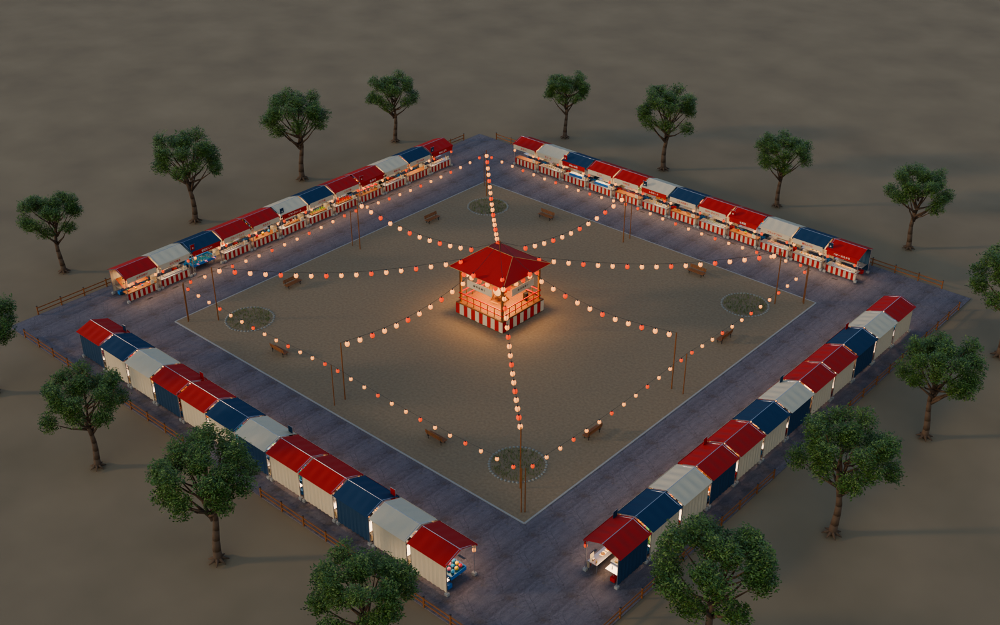

# vr-ennichi — 日本の縁日 Blender シーン

48種類の屋台と中央の盆踊りやぐらを配置した、共同研究用の3D環境です。通路中心線は一辺50 m、一周200 m、幅6 mです。



## モデルを開く

完成モデルは **[`outputs/ennichi_50m.blend`](outputs/ennichi_50m.blend)** です。地面と背景画像は内蔵され、日本語看板はメッシュ化されています。

モデル本体・旧版・HDRIは **Git LFS** で管理しています。取得するコンピュータにGitとGit LFSをインストールしてから、次を実行してください。

```sh
git clone https://github.com/t-inamura/vr-ennichi.git vr-ennichi
cd vr-ennichi
git lfs install --local
git lfs pull
```

その後、Blenderから `outputs/ennichi_50m.blend` を開きます。macOSでは次のコマンドも使えます。

```sh
open -a Blender outputs/ennichi_50m.blend
```

初回制作時の検証環境はBlender 5.2.2 LTS / macOSです。歩行操作、店舗一覧、カメラ、再生成方法は [モデルの説明書](outputs/README_日本語.md) を参照してください。

## ファイル構成

| 場所 | 内容 |
|---|---|
| `outputs/ennichi_50m.blend` | 現行の編集可能なシーン |
| `outputs/01_*.png` 〜 `05_*.png` | 5視点のレンダリング画像 |
| `outputs/build_ennichi.py` ほか | モデル生成・描画スクリプト |
| `outputs/assets/` | 地面テクスチャとHDRI |
| `outputs/site_plan.svg` | 店舗・寸法入りの配置図 |
| `outputs/scene_manifest.json` / `validation.json` | 構成情報と制作時の検証記録 |
| `work/` | 制作途中のモデル・画像・修正スクリプト・ログ・素材取得情報 |
| `outputs/ennichi_50m.blend1` | Blenderのバックアップ |

成果物と制作過程を全て管理し、PythonのキャッシュやOSの一時ファイルだけを除外します。`work/` のスクリプトは制作時の記録で、順番に実行する再構築手順ではありません。再生成には `outputs/build_ennichi.py` を使用してください。

## 共同作業

更新・取得・復元の手順は **[GitHub管理ガイド](outputs/GITHUB_GUIDE.md)** にまとめています。リポジトリ名・ローカル作業フォルダ名は `vr-ennichi` です。

`.blend` はバイナリのため、同じシーンの同時編集は担当を調整してください。変更時にはプレビュー画像と説明も更新すると、共同研究者が変更点を確認できます。公開リポジトリの閲覧・取得は誰でも可能ですが、直接のpushには書き込み権限が必要です。

## 素材とライセンス

地面と背景にはPoly HavenのCC0素材を使用しています。

- [Aerial Asphalt 01](https://polyhaven.com/a/aerial_asphalt_01) — Rob Tuytel
- [Kloppenheim 06 (Pure Sky)](https://polyhaven.com/a/kloppenheim_06_puresky) — Greg Zaal / Jarod Guest
- [Poly Havenのライセンス](https://polyhaven.com/license)

参考サイトの写真や日本語フォントファイルは同梱していません。独自モデル・コードについては、このリポジトリに包括的なオープンソースライセンスを設定していません。第三者への再配布・利用許諾は管理者と確認してください。素材の由来と表現上の制約は [モデルの説明書](outputs/README_日本語.md) に記載しています。

## Unity実験アプリ（実装初版）

端末内ログ保存とキーボード移動を備えるUnityプロジェクトを `Unity/` に追加しました。Editorの許容範囲は **Unity 6000系正式版の6000.0.65f1以降**（6000.0.81f1も含む）です。起動・操作・保存先は [日本語手順](docs/README_UNITY_日本語.md)、現在の検証状態は [検証記録](docs/VALIDATION.md) を参照してください。Unity実機確認とモデルの視覚承認前の初版であり、完成済み実験アプリとは扱わないでください。元のBlenderマスターと制作履歴は変更していません。

2026-10-21に保存済みパッチから実装を復元し、76ファイルの一致を検証して実装ブランチへ登録しました。[復元記録](docs/RESTORATION_2026-10-21.md) に復元元、チェックサム、今回の検証範囲を記載しています。形状確認用の約114MBの派生アセットZIPは別管理であり、本番アセット・実行ビルドではありません。
